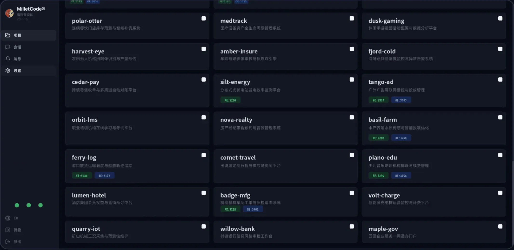
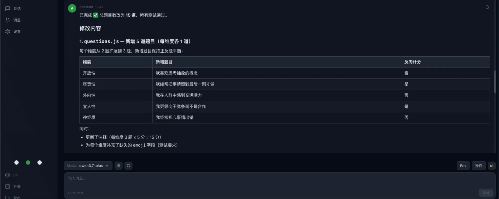

# Milletcode — Multi-Agent Orchestration Platform

English | [简体中文](README.zh-CN.md)

[](https://github.com/milletcode/milletcode/releases)
[](./LICENSE)
[](https://hub.docker.com/r/milletcode/milletcode)

Every AI coding agent in one workbench.

AI coding tools are evolving from autocomplete assistants into agents that can read a project, edit files, run commands and execute tests. But once a team starts using these tools heavily, new problems appear: agents live in scattered terminals; local and remote machines need separate handling; mid-task, it is hard to tell whether a job is running, waiting for approval, or already dead; and code edits, terminal debugging, file browsing and Git operations lack a single entry point.

Milletcode is a self-hosted web workbench that brings agents like Claude Code, SmartCode and Codex — together with local and remote projects — into one browser console, covering project discovery, task dispatch, live output, human approval, file management and result acceptance.

- Website: <https://milletcode.com>
- User manual: [docs/user-manual](docs/user-manual/) (English / 简体中文)
- Issues: <https://github.com/milletcode/milletcode/issues>

## Inside the Console

From projects to sessions, from dispatch to delivery — all in the browser.

| [Projects Console](docs/images/home/projects.webp) | [Session Workspace](docs/images/home/session.webp) |
|---|---|
|  |  |
| Orgs, projects and agents unified in one card view | Dispatch tasks, watch live output, switch models and environments freely |

## Why a Multi-Agent Workbench

A developer used to maintain a single dev environment. With coding agents in the mix, the shape of the work changes: one agent fixes a backend issue, another handles a frontend page, while long-running tasks churn on a remote build machine. Agents stop being editor plugins and become execution units that take tasks, operate on projects and deliver results.

That raises a set of management questions:

- **How do projects get unified access?** Local directories, remote servers and different orgs shouldn't each need their own workflow.
- **How are tasks tracked?** A long task can run for tens of minutes; it can't depend on someone watching a terminal.
- **How is execution kept under control?** Deleting files, changing configs and running risky commands still need human approval.
- **How are results accepted?** A finished conversation isn't a finished delivery — you still need to review files, check Git changes, run tests and debug services.
- **How do different agents coexist?** Teams may use different CLIs, models, accounts and API gateways, and don't want to be locked into a single tool.

To be clear, the "orchestration" Milletcode refers to is unified access, task dispatch and process management for agents, projects, sessions and runtimes — not another framework that decomposes tasks and brokers inter-agent communication. It does not aim to replace existing coding agents; it makes them easier to use and manage day to day.

## Core Features

### 1. Unified management across orgs, projects and agents

Milletcode onboards projects through "discovery paths". Point it at a local or remote directory and the platform scans its direct children, identifying directories containing `README.md` or `.git` as projects, shown as cards in the console.

Under each project you can create multiple agent sessions. Every session is addressed by a readable composite key:

```
org/project/agent-name/session-name
```

For example, `milletcode/order-service/claude-code/default`. Compared to a random UUID, this form is friendlier in URLs, REST APIs and automation scripts. Session metadata and output are persisted in an embedded redb database and remain viewable and resumable across backend restarts. The model also makes "one project, several parallel tasks" natural: open a session per task instead of churning a single terminal context.

### 2. Multiple agents, with maturity labeled explicitly

Milletcode integrates agents through adapters. Current status:

| Agent / adapter | Status |
|---|---|
| Claude Code | Stable, enabled by default, PTY-based with streaming output |
| SmartCode | Alpha, streaming adapter |
| Codex | Beta, enable on demand |
| DeepSeek | HTTP API adapter in development |

Each agent instance can be configured with its own CLI path, API key, launch arguments, release channel and approval policy — one workbench can serve different environments without forcing every project to share a global set of environment variables.

The previously planned codewhale and opencode integrations are on hold; we will re-prioritize them based on real user feedback. Rather than growing the adapter count quickly, we prefer to keep shipped adapters usable and consistent — capabilities still in development or testing are labeled as such, not lumped into "fully supported".

### 3. Remote projects over SSH

Plenty of engineering work doesn't happen on your laptop — it happens on remote dev machines, test servers and dedicated build nodes. Milletcode lets you attach any SSH-reachable host's directory as a discovery path. Once a session starts, the agent reads and writes files and runs commands directly on that host; the browser is just the unified window.

Three things make this practical:

- Host aliases, ports, keys and jump hosts (ProxyJump) come straight from `~/.ssh/config`;
- SSH connections are pooled and reused across sessions;
- Remote project files are managed over SFTP, identically to local ones.

Teams don't need to design a new remote-execution protocol, and the target host runs no Milletcode-specific daemon — if it speaks SSH and has the agent CLI installed, it can join the workbench.

### 4. Live output with human approval

The more automation, the sharper the control boundary needs to be. Milletcode streams agent output, approval requests and status changes over WebSocket. Session states include Starting, Running, WaitingApproval, Stopped, Completed and Error — no more guessing from process status whether a task is alive.

When an agent requests authorization, the platform surfaces an approval prompt where you can approve or decline with a comment. Protected commands such as `kubectl delete` or `rm -rf` can be forced into the approval flow via configuration. An `auto_approve` option exists, but we recommend enabling it only in fully trusted, well-isolated environments — keeping human approval as the default is the safer choice.

Idle sessions can push Lark notifications, so long tasks that finish unattended — or agents waiting for input nobody noticed — don't fall through the cracks.

### 5. From dispatch to delivery, in the same workbench

Finishing a coding task usually involves actions "outside the conversation". Milletcode integrates them into the same web workbench:

- Browse, read and download project files;
- Manage remote files over SFTP;
- Run common Git operations;
- Open a browser terminal;
- Forward remote service ports;
- Reach remote services through built-in tunnels;
- Install and distribute official or third-party skill packages.

Browser terminal and port forwarding are currently Alpha, and the skills module is still evolving. They are meant for trusted environments, not as a general remote-access solution to be exposed to the public internet.

### 6. Self-hosted and integrable — data stays in your environment

Milletcode is self-hosted: project files, session data, approval records and runtimes are all managed by the deployer. The backend exposes a REST API and a WebSocket, so beyond the browser you can wire project queries, message sending, approval handling and session resumption into existing platforms or automation.

The project is licensed under AGPL-3.0-only — see the [License](#license) section.

### 7. Dual GPT API endpoints: fast primary/backup switching

In practice, GPT API stability directly affects the continuity of dependent agent features. Milletcode supports dual GPT API configurations: maintain a primary and a backup line in the workbench and use them with model selection. Daily requests go through the primary; when it fails or becomes unreachable, switch to the pre-validated backup to restore access — no ad-hoc reconfiguration of the runtime needed.

We recommend using independent endpoints and credentials for the two lines, and verifying the backup ahead of time, so a single failure doesn't take out both.

## Architecture

```
┌─────────────────────────────────────┐
│  Svelte 5 + TypeScript frontend     │
│  Projects / Sessions / Approval     │
│  Files / Terminal UI                │
└──────────────┬──────────────────────┘
        REST API + WebSocket
┌──────────────▼──────────────────────┐
│  Rust + Axum backend                │
│  Agent Adapters · Session Manager   │
│  Project Manager · Terminal         │
│  PortForward / Tunnel · Auth        │
│  Skills / Notifications             │
└──────────────┬──────────────────────┘
               │
      ┌────────┴────────┐
      │                 │
  Local projects   SSH remote projects
      │                 │
  Local agents     Remote agent CLIs
      │                 │
      └────────┬────────┘
               │
         redb persistence
```

The backend is built with Rust, Axum, Tokio and redb; the frontend with Svelte 5, TypeScript, Vite and Tailwind CSS. In production builds the frontend bundle is embedded into the backend binary, so deployment doesn't mean maintaining two runtime services.

## How Milletcode Compares with Paseo and Multica

In the multi-agent management space, both Paseo and Multica are worth watching. Paseo leans toward a cross-device agent development environment, offering desktop, mobile, web and CLI clients, with fairly complete support for parallel agents, Git worktrees, plugins and a broad range of agent adapters. Multica is closer to a task-management platform where humans and AI agents work together, built around issues, task assignment, execution records, skill reuse, team collaboration and automation triggers.

Milletcode takes a different emphasis: the browser as the unified workbench, SSH as the remote execution channel, reusing as much of the target environment's existing infrastructure as possible — instead of deploying another set of platform control components on every target machine.

### The core difference is not "SSH or not", but "what's on the other end of the SSH connection"

Worth noting: Paseo also supports connecting to remote environments over SSH. So the difference can't be summarized as "Milletcode uses SSH and the others don't". The real distinction is the remote architecture:

- **Milletcode**: the control side executes commands and launches agent CLIs directly on the target host over SSH, and manages files over SFTP. The target host runs no Milletcode-specific daemon.
- **Paseo**: SSH mainly serves as the transport from client to Paseo daemon. Per its official connectivity docs, the remote host must have the Paseo daemon running beforehand — the SSH connection itself won't install, start or configure it.
- **Multica**: work machines run a Multica agent daemon, which detects agent CLIs, registers runtimes, receives tasks, starts execution and reports results back.

Simplified remote chains:

```
Milletcode: browser → Milletcode control side → SSH → agent CLI on the target host

Paseo:      client → SSH / TCP / Relay → remote Paseo daemon → agent CLI

Multica:    Multica Server → WebSocket → Multica daemon on work machines → agent CLI
```

### Comparison overview

| Dimension | Milletcode | Paseo | Multica |
|---|---|---|---|
| Product focus | Unified web workbench for projects, sessions, remote environments and dev tooling | Cross-device, multi-agent development environment | Task and collaboration platform for mixed human–agent teams |
| Remote execution | Direct SSH execution, SFTP file management | Client connects to an existing daemon via SSH, TCP or Relay | Agent daemon registers runtimes and receives server-side tasks |
| Platform component on target hosts | No Milletcode-specific daemon needed | Requires the Paseo daemon | Requires the Multica daemon |
| Agent CLI on target hosts | Required | Required | Required |
| Intranet & bastion access | Reads SSH config, supports ProxyJump and multi-hop chains | Can reuse OpenSSH config, but the remote daemon must already be running | Organized mainly around daemon-to-server connections |
| Client coverage | Web | Desktop, mobile, web, CLI | Web, desktop, mobile, CLI, API |
| Adapter breadth | Focused today, opening up by maturity | Broader adapter coverage | Broader adapter coverage |
| Task organization | "Org–project–session" with parallel multi-project, multi-agent sessions, live status, human approval, resumption and delivery acceptance | Worktrees, parallel agents and plugin extensions; focused on dev environment and cross-device experience | Issues, Squads and Autopilot; focused on task flow and team collaboration |
| Best suited for | Teams managing local, remote and intranet projects together, reusing existing SSH/bastion/permission systems, valuing lightweight deployment, controllability and delivery acceptance | Users who value mobile, cross-device operation and parallel multi-agent development | Teams organizing human–agent collaboration through issues and automated workflows |

### What "no dedicated remote daemon" buys you in practice

"Installing one less component" doesn't automatically mean "more secure", but in enterprise intranets and compliance-heavy environments it does deliver concrete engineering wins:

- **A smaller deployment and operations footprint on target hosts.** No Milletcode control-plane process to run, upgrade, monitor and keep alive. For servers already covered by a unified SSH operations regime, onboarding cost is lower.
- **No extra control plane or listening port.** Remote command execution and file transfer all ride the SSH channel; there's no additional Milletcode service port to open on the target host, which helps contain new network entry points and attack surface.
- **Reuse of existing enterprise access controls.** Many enterprises already run account authorization, key rotation, host fingerprints, bastions, jump hosts and access auditing around SSH. Milletcode reuses those as-is instead of asking teams to design a new remote access path for an agent platform — especially fitting for intranet servers reachable only through a bastion: the agent still runs on the intranet host, and neither code nor execution environment moves to an external SaaS.

> Note: SSH is only the transport and access-control foundation; it doesn't make the system "compliant" by itself. Actual security still depends on account permissions, key management, host fingerprint verification, approval policies and the agent CLI's own permission configuration.

## Getting Started

### One-line install (recommended)

macOS / Linux, no development tooling required:

```bash
curl -sfL https://milletcode.com/install.sh | sh -
```

The installer downloads the prebuilt binary for your platform and sets everything up:

1. Installs to `/usr/local/bin/milletcode` (`MILLETCODE_BIN_DIR` to override; sudo only when needed);
2. Creates the workspace `~/Codes/milletcode-workspace` and generates `~/.milletcode/config.toml` with a **random login and password** (an existing config is never touched);
3. Registers a system service (launchd on macOS / systemd on Linux, service name `milletcode`), enabled at boot and started immediately;
4. **The last line of the installer output is your randomly generated login credentials** — save it.

Open <http://127.0.0.1:9527> and sign in. Script-installed instances listen on 9527, which never clashes with dev instances (3030), so both can coexist on one machine. Useful variables: pin a version with `MILLETCODE_VERSION=vX.Y.Z`, bind locally only with `MILLETCODE_HOST=127.0.0.1`; see `sh install.sh --help` for the full list. Upgrade: re-run the same one-liner.

### Docker

The official image is published on Docker Hub: `main` branch → `milletcode/milletcode:latest` (traceable tag `main-<sha8>`), `staging` branch → `:staging`.

```bash
docker run -d --name milletcode -p 3030:3030 \
  -v milletcode-data:/config \
  -v "$HOME/.milletcode/config.toml:/home/coder/.milletcode/config.toml" \
  milletcode/milletcode:latest
```

The container runs as the `coder` user: session data lives in the `/config` volume, and the config file is mounted (subPath) at `/home/coder/.milletcode/config.toml` — set `auth.mode` (see [Configuration](#configuration)) before starting.

### Build from source (development)

You need: Rust 1.75+, Node.js 18+ with npm, Git and build tooling, plus an installed and logged-in agent CLI (e.g. Claude Code). SSH key access is required for remote projects.

```bash
git clone https://github.com/milletcode/milletcode.git
cd milletcode
make init
```

`make init` runs dependency checks, config initialization, build & install, and system service registration in one pass, generating `~/.milletcode/config.toml` with a random login and password and an initial workspace. Linux uses systemd; macOS uses LaunchAgent. After editing the config:

```bash
make service-restart
```

For local use, open <http://127.0.0.1:3030>; for server deployments, substitute the IP or domain. To participate in development (local setup, tests, commit conventions), read [CONTRIBUTING.md](CONTRIBUTING.md).

### Development mode

```bash
make dev
```

The backend runs on `127.0.0.1:3030`, the frontend dev server on `:5180`.

## Configuration

`~/.milletcode/config.toml` is generated on first start. `auth.mode` is required — the service refuses to start until it is set. A minimal setup:

```toml
[auth]
mode = "plain"

[auth.plain]
user = "admin"
password = "change-me"

[project.discovery_paths.default]
path = "~/Codes"          # local project root to scan

[agent]
default_agent = "claude"
approval_timeout_secs = 600

[agent.instances.claude]
name = "Claude Code"
enabled = true
# path = "/path/to/claude"        # override the CLI binary
# api_key = "sk-ant-..."          # injected as ANTHROPIC_API_KEY
# extra_args = []
# auto_approve = false
# release_channel = "stable"
```

Here `~/Codes` is the project root. Given a layout like:

```
~/Codes/
├── order-service/     # has .git/ and README.md
└── web-console/       # has .git/ and README.md
```

the scan identifies `order-service` and `web-console` as two projects. After changing config and restarting, log in and hit "Scan Projects" to see the cards.

### Attaching remote hosts (including bastions)

Any SSH-reachable directory can be attached as a discovery path. First edit `~/.ssh/config` on the machine running Milletcode — for example, reaching an intranet host through a bastion:

```ssh-config
Host corp-bastion
  HostName bastion.example.com
  User ops
  IdentityFile ~/.ssh/id_ed25519_bastion
  StrictHostKeyChecking yes

Host intranet-dev
  HostName 10.20.8.15
  User dev
  IdentityFile ~/.ssh/id_ed25519_dev
  ProxyJump corp-bastion
  StrictHostKeyChecking yes
```

Then add it to `~/.milletcode/config.toml`:

```toml
[project.discovery_paths.intranet]
path = "~/projects"
hostname = "intranet-dev"      # alias from ~/.ssh/config
remote_mode = "ssh"

[project.discovery_paths.intranet.paths]
claude = "/home/dev/.local/bin/claude"   # CLI path on the remote host
```

Run `make service-restart` and rescan. Sessions run the agent directly on the remote host; file browsing and downloads go over SFTP. SSH private keys stay on the control side and are never shipped to the browser.

Full field reference: [multi-agent configuration](docs/user-manual/zh-CN/multi-agent-claude.md) and [remote directories](docs/user-manual/zh-CN/remote-directories.md) in the user manual.

## API

The backend exposes a REST API under `/api` plus a WebSocket for real-time session streaming. Sessions are addressed by composite key `/api/sessions/{org}/{project}/{agent_name}/{session_name}` with sub-resources such as `/message`, `/approve`, `/stop`, `/restore`, `/config`, `/history` and `/files`.

Common entry points:

| Method | Path | Description |
|--------|------|-------------|
| GET | `/api/health` | Health check |
| GET | `/api/agents` | List configured agent instances |
| GET | `/api/projects` | List discovered projects |
| GET | `/api/sessions` | List all sessions |
| POST | `/api/sessions/{org}/{project}/{agent}/{name}/message` | Send a message to a session |
| POST | `/api/sessions/{org}/{project}/{agent}/{name}/approve` | Resolve an approval prompt |

To integrate Milletcode into internal platforms, configure a static API Token starting with `sk-` under `[auth.plain]` and call the API with a Bearer token:

```bash
# List projects
curl -H "Authorization: Bearer $MILLETCODE_TOKEN" \
  http://127.0.0.1:3030/api/projects

# Append a task to an existing session
curl -X POST \
  -H "Authorization: Bearer $MILLETCODE_TOKEN" \
  -H "Content-Type: application/json" \
  -d '{"content":"Run the tests and summarize the failures"}' \
  http://127.0.0.1:3030/api/sessions/default/order-service/claude-code/default/message
```

The complete REST/WebSocket reference lives in [docs/developer-guide.md](docs/developer-guide.md). Teams that already have a dev portal or CI system can use Milletcode as the agent-execution and session-management layer, rather than replacing their existing entry points.

## Deployment & Security Notes

Milletcode manages more than chat logs — it manages real projects, terminals and remote hosts — so define your security boundary before deploying. At minimum:

- **Don't expose port 3030 directly to the public internet.** Bind `127.0.0.1` and put Nginx or Caddy with TLS in front, or restrict source IPs with a firewall.
- **Keep human approval on by default.** Don't flip on `auto_approve` just to chase automation.
- **Only attach hosts you own and trust.** A remote directory means the agent can execute commands on that host.
- **Treat Alpha features with care.** The browser terminal exposes the target environment's shell to workbench users; port forwarding widens access to remote services.
- **Guard your API keys, passwords and SSH private keys.** Combine least-privilege accounts, network segmentation and access control.

## Sponsor

Open source runs on coffee — if Milletcode helps you, consider buying us one.

| Bitcoin | Ethereum |
|---------|----------|
|  |  |

Other methods (WeChat / Alipay and the latest codes) are on our website: [milletcode.com](https://milletcode.com).

## License

Copyright © 杭州玄米科技有限公司 (Hangzhou Milletcode Technology Co., Ltd.)

This project is licensed under the **GNU Affero General Public License v3.0 only** ([AGPL-3.0-only](./LICENSE)).

In short: you are free to use, study, modify and redistribute this software, **but if you run a modified version as a network service (e.g., a hosted platform), you must offer the corresponding source code to the users of that service.** Closed-source hosted derivatives of this project are not permitted.

**Milletcode®** and the Milletcode logo are registered trademarks of Hangzhou Milletcode Technology Co., Ltd. (杭州玄米科技有限公司). The license covers the code, not the brand — see [TRADEMARKS.md](TRADEMARKS.md) (bilingual: English / 简体中文) for what uses of the name and logo are permitted.
