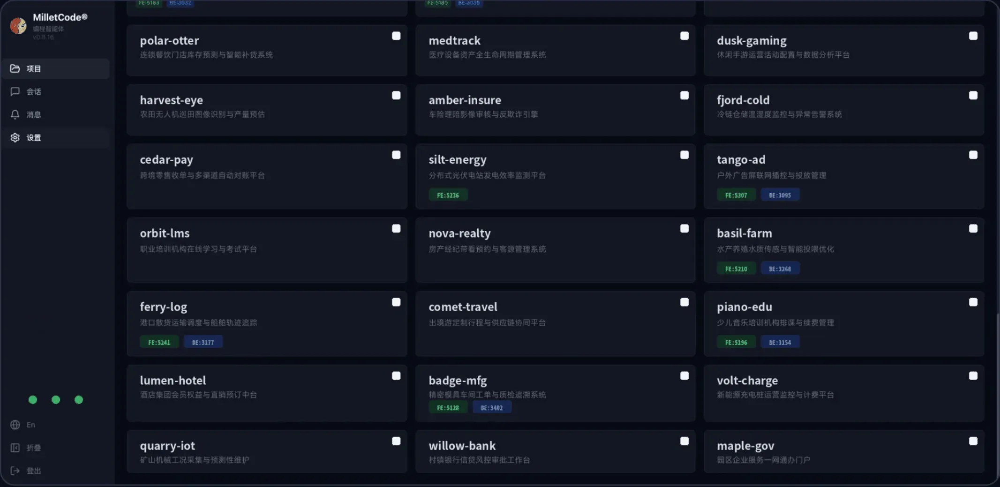
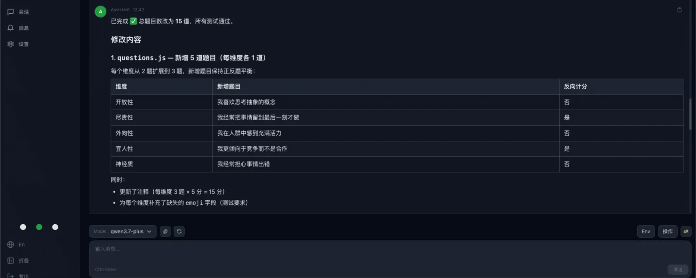

# Milletcode — 多 Agent 调度平台

[简体中文](README.zh-CN.md) | [English](README.md)

[](https://github.com/milletcode/milletcode/releases)
[](./LICENSE)
[](https://hub.docker.com/r/milletcode/milletcode)

把 AI 编程智能体装进同一个工作台。

AI 编程工具正在从「代码补全助手」进化为能够阅读项目、修改文件、执行命令和运行测试的编程智能体。但当团队真正开始高频使用这些工具时，新的问题也随之出现：不同智能体散落在不同的终端里；本地项目与远程服务器需要分别管理；任务执行到一半，难以判断是在运行、等待审批，还是已经异常退出；代码修改、终端调试、文件查看和 Git 操作之间，也缺乏统一的工作入口。

Milletcode 是一个自托管的 Web 工作台，可以将 Claude Code、SmartCode、Codex 等 AI 编程智能体，以及本地和远程项目统一接入浏览器，完成项目发现、任务下达、实时输出、人工审批、文件管理和结果验收。

- 官网：<https://milletcode.com>
- 使用手册：[docs/user-manual](docs/user-manual/)（简体中文 / English）
- 问题反馈：<https://github.com/milletcode/milletcode/issues>

## 控制台一览

从项目到会话，从任务下达到结果验收，全在浏览器里完成。

| [项目控制台](docs/images/home/projects.webp) | [会话工作台](docs/images/home/session.webp) |
|---|---|
|  |  |
| 多组织、多项目、多智能体统一纳管，卡片视图一目了然 | 任务下达、实时输出、模型与环境随手切换 |

## 为什么需要多 Agent 调度平台

过去，一个开发者通常只需要维护一套开发环境。引入 AI 编程智能体之后，研发工作的组织方式开始发生变化：我们可能会让一个智能体修复后端问题，让另一个智能体处理前端页面，同时在远程开发机上运行耗时任务。此时，智能体已经不只是编辑器插件，而更像是一个个可以接收任务、操作项目并交付结果的执行单元。

随之而来的是几个管理问题：

- **项目如何统一接入？** 本地目录、远程服务器和不同组织的项目，不应该分别使用一套操作方式。
- **任务如何持续跟踪？** 一个长任务可能运行几十分钟，不能依赖开发者一直盯着终端。
- **执行过程如何保持可控？** 删除文件、修改配置、执行高风险命令，仍然需要人工审批。
- **执行结果如何验收？** 对话结束并不等于交付完成，还需要查看文件、检查 Git 变更、运行测试和调试服务。
- **不同智能体如何共存？** 团队可能同时使用不同 CLI、模型、账号和 API 网关，不希望被单一工具绑定。

需要说明的是，Milletcode 所强调的「调度」，主要是对智能体、项目、会话和运行环境进行统一接入、任务分派与过程管理，而不是定义一个自动拆解任务、控制智能体间通信的协作工作流框架。它不准备取代现有编程智能体，而是让这些智能体更容易被日常使用和管理。

## 核心特性

### 1. 多组织、多项目、多智能体统一管理

Milletcode 以「发现路径」接入项目。配置一个本地或远程目录后，平台会扫描其直接子目录，将包含 `README.md` 或 `.git` 的目录识别为项目，并在控制台中以卡片形式展示。

项目之下可以创建多个智能体会话。每个会话使用便于理解的复合键：

```
org/project/agent-name/session-name
```

例如 `milletcode/order-service/claude-code/default`。相比一串随机 UUID，这种标识更容易出现在 URL、REST API 和自动化脚本中。会话元数据和输出由嵌入式 redb 数据库持久化，后端重启后仍可查看和恢复。这种模型也让「一个项目并行处理多个任务」变得更自然：可以为不同任务建立独立会话，而不必在同一个终端上下文里反复切换。

### 2. 接入不同智能体，并明确标注成熟度

Milletcode 通过适配器接入不同智能体。当前主要能力状态如下：

| 智能体或适配器 | 当前状态 |
|---|---|
| Claude Code | 稳定支持，默认启用，基于 PTY 运行并流式输出 |
| SmartCode | Alpha，流式适配 |
| Codex | Beta，可按需启用 |
| DeepSeek | HTTP API 适配器开发中 |

平台支持为智能体实例分别配置 CLI 路径、API Key、启动参数、发布渠道和审批策略。同一套工作台可以面向不同运行环境使用不同配置，而不必让所有项目共享一份全局环境变量。

此前规划中的 codewhale、opencode 接入目前已暂缓，后续将根据真实用户反馈和使用场景重新评估优先级。相比快速增加适配器数量，我们更希望优先保证已接入能力的可用性和一致性——对于仍在开发或测试中的能力，我们会明确标注状态，而不是笼统地写成「全面支持」。

### 3. 通过 SSH 管理远程项目

很多研发任务并不发生在开发者本机，而是在远程开发机、测试服务器或专用构建节点上。Milletcode 可以将任意 SSH 可达主机的目录配置为项目发现路径。创建会话后，智能体直接在远程主机上读写文件、执行命令，浏览器只是统一的操作窗口。

它主要具有三个特点：

- 复用 `~/.ssh/config` 中的主机别名、端口、私钥和跳板机（ProxyJump）配置；
- 通过 SSH 连接池跨会话复用连接；
- 使用 SFTP 管理远程项目文件，本地与远程项目采用一致的操作方式。

这意味着团队不必为了接入智能体再设计一套远程执行协议，目标主机上也不需要运行 Milletcode 专用 daemon——只要主机支持 SSH、安装了相应的智能体 CLI，就可以纳入工作台。

### 4. 实时输出与人工审批并存

自动化程度越高，越需要清晰的控制边界。Milletcode 使用 WebSocket 推送智能体输出、审批请求和状态变化。会话状态包括启动中、运行中、等待审批、已停止、已完成和异常等，开发者不必通过进程状态猜测任务是否仍在运行。

当智能体发起需要授权的操作时，平台会展示审批提示，使用者可以选择批准或拒绝，并附加评论。对于 `kubectl delete`、`rm -rf` 等受保护命令，还可以通过配置强制进入审批流程。平台也提供 `auto_approve` 选项，但我们建议只在完全信任、隔离良好的环境中开启——日常使用时，保留人工审批仍然是更稳妥的默认选择。

此外，闲置会话可以推送 Lark 通知，减少长任务完成后无人跟进、或者智能体等待输入却无人发现的情况。

### 5. 从任务下达到结果验收，尽量留在同一个工作台

一个编程任务真正完成，通常还包括许多「对话之外」的动作。为此，Milletcode 将以下能力集成到了同一个 Web 工作台：

- 浏览、读取和下载项目文件；
- 通过 SFTP 管理远程文件；
- 执行常用 Git 操作；
- 打开浏览器终端；
- 转发远程服务端口；
- 通过隧道访问远程服务；
- 安装和分发官方或第三方技能包。

其中，终端直连与端口转发目前属于 Alpha 功能，技能模块仍处在持续完善阶段。它们适合在受信任的环境中使用，不应被理解为已经可以无条件暴露到公网的通用远程访问方案。

### 6. 自托管、可集成，数据留在自己的环境

Milletcode 采用自托管模式，项目文件、会话数据、审批记录和运行环境都由部署者自行管理。后端提供 REST API 和 WebSocket 接口，除了通过浏览器操作，也可以将项目查询、消息发送、审批处理和会话恢复接入已有的研发平台或自动化流程。

项目采用 AGPL-3.0-only 许可证，详见[许可证](#许可证)一节。

### 7. 双线 GPT API：主备配置快速切换

在实际研发场景中，GPT API 的稳定性会直接影响相关智能体功能的连续性。Milletcode 支持双线 GPT API 配置，可以在工作台中分别维护主线路与备用线路的 API 配置，并结合模型选择使用：日常请求走主配置；当主站出现故障或服务不可用时，切换到已提前准备好的备用配置即可快速恢复访问，无需临时修改整套运行环境。

建议主备线路使用相互独立的服务入口与凭据，并提前验证备用配置的可用性，避免主备线路同时受到同一故障影响。

## 技术架构

```
┌─────────────────────────────────────┐
│  Svelte 5 + TypeScript 前端          │
│  项目 / 会话 / 审批 / 文件 / 终端界面 │
└──────────────┬──────────────────────┘
        REST API + WebSocket
┌──────────────▼──────────────────────┐
│  Rust + Axum 后端                    │
│  Agent Adapters · Session Manager    │
│  Project Manager · Terminal          │
│  PortForward / Tunnel · Auth         │
│  Skills / Notifications              │
└──────────────┬──────────────────────┘
               │
      ┌────────┴────────┐
      │                 │
   本地项目          SSH 远程项目
      │                 │
   本地智能体        远程智能体 CLI
      │                 │
      └────────┬────────┘
               │
          redb 持久化
```

后端使用 Rust、Axum、Tokio 和 redb；前端使用 Svelte 5、TypeScript、Vite 与 Tailwind CSS。生产构建时，前端产物会嵌入后端二进制，部署时不必分别维护两套运行时服务。

## 与 Paseo、Multica 相比，Milletcode 的差异在哪里

在多 Agent 管理领域，Paseo 和 Multica 都是值得关注的产品。Paseo 更偏向跨设备的智能体开发环境，提供桌面、移动端、Web 和 CLI 客户端，在并行 Agent、Git worktree、插件体系及智能体适配广度方面具有较完整的能力。Multica 则更像一个人与 AI 智能体共同工作的任务管理平台，围绕 Issue、任务分派、执行记录、技能复用、团队协作和自动化触发构建工作流。

Milletcode 选择了另一个侧重点：以浏览器为统一工作台，以 SSH 为远程执行通道，尽量复用目标环境已有的基础设施，而不是在每台目标机器上再部署一套平台控制组件。

### 核心差异不是「是否支持 SSH」，而是「SSH 的另一端是什么」

需要特别说明的是，Paseo 同样支持通过 SSH 连接远程环境，因此差异不能简单概括为「Milletcode 使用 SSH，而其他产品不使用」。真正的区别在于远程架构：

- **Milletcode**：控制端直接通过 SSH 在目标主机上执行命令、启动智能体 CLI，并通过 SFTP 管理文件。目标端不需要运行 Milletcode 专用 daemon。
- **Paseo**：SSH 主要作为客户端到 Paseo daemon 的传输通道。按照其官方连接文档，远程主机需要事先启动 Paseo daemon，SSH 连接本身不会安装、启动或配置该 daemon。
- **Multica**：工作机器需要运行 Multica agent daemon。daemon 负责检测智能体 CLI、注册运行时、接收任务、启动执行并回传结果。

三条远程链路可以简化为：

```
Milletcode：浏览器 → Milletcode 控制端 → SSH → 目标主机上的智能体 CLI

Paseo：     客户端 → SSH / TCP / Relay → 远程 Paseo daemon → 智能体 CLI

Multica：   Multica Server → WebSocket → 工作机器上的 Multica daemon → 智能体 CLI
```

### 对比概览

| 对比维度 | Milletcode | Paseo | Multica |
|---|---|---|---|
| 产品侧重点 | 项目、会话、远程环境与研发工具的统一 Web 工作台 | 跨设备、多 Agent 的智能体开发环境 | 人与 Agent 混合团队的任务和协作平台 |
| 远程执行方式 | SSH 直接执行，SFTP 管理远程文件 | 客户端通过 SSH、TCP 或 Relay 连接既有 daemon | Agent daemon 注册运行时并接收服务端任务 |
| 目标端平台组件 | 无需安装 Milletcode 专用 daemon | 需要运行 Paseo daemon | 需要运行 Multica daemon |
| 目标端智能体 CLI | 需要 | 需要 | 需要 |
| 内网与跳板机接入 | 读取 SSH 配置，支持 ProxyJump 和多跳链路 | 可复用 OpenSSH 配置，但仍需远端 daemon 已运行 | 主要围绕 daemon 与服务端的连接组织运行时 |
| 客户端覆盖 | Web | 桌面、移动端、Web、CLI | Web、桌面、移动端、CLI、API |
| 智能体适配广度 | 当前较为聚焦，按成熟度逐步开放 | 适配范围更广 | 适配范围更广 |
| 任务组织与过程管理 | 以「组织—项目—会话」组织任务，支持多项目、多智能体会话并行，结合实时状态、人工审批、会话恢复和结果验收 | 以 worktree、并行 Agent 和插件扩展为主，侧重开发环境与跨端操作体验 | 以 Issue、Squad 和 Autopilot 为中心，侧重任务流转与团队协作 |
| 更适合的场景 | 需要统一管理本地、远程及内网项目，希望复用现有 SSH、堡垒机与权限体系，并重视轻量部署、过程可控和交付验收的研发团队 | 重视移动端、跨设备操作和多 Agent 并行开发体验的用户 | 希望通过 Issue 和自动化工作流组织人机协作的团队 |

### 无专用远端 daemon，带来什么实际价值

「少安装一个组件」并不自动等于「绝对更安全」，但在企业内网和高合规环境中，它确实能带来一些容易落地的工程收益：

- **减少目标端的软件部署和运维范围。** 目标机器不需要额外运行 Milletcode 控制面进程，也不需要为此增加一套升级、监控和常驻进程管理制度。对于已经拥有统一 SSH 运维体系的服务器，接入成本更低。
- **减少额外的平台控制面和监听端口。** 远程命令执行和文件传输都通过 SSH 通道完成，不需要为了平台控制在目标端另外开放一个 Milletcode 服务端口，有助于减少新增网络入口和潜在攻击面。
- **复用企业已有的访问控制体系。** 很多企业已经围绕 SSH 建立了账号授权、密钥轮换、主机指纹、堡垒机、跳板机和访问审计制度。Milletcode 可以直接复用这些既有能力，而不要求团队为智能体平台重新设计一套远程接入路径。对于只允许通过堡垒机访问的内网服务器尤其合适：智能体仍然运行在目标内网主机上，代码和执行环境不需要迁移到外部 SaaS。

> 说明：SSH 只是传输与访问控制基础，并不会自动让整个系统「合规」。实际安全性仍取决于账号权限、密钥管理、主机指纹校验、审批策略以及智能体 CLI 本身的权限配置。

## 快速开始

### Docker（推荐）

官方镜像发布在 Docker Hub：`main` 分支 → `milletcode/milletcode:latest`（可追溯 tag `main-<sha8>`），`staging` 分支 → `:staging`。

```bash
docker run -d --name milletcode -p 3030:3030 \
  -v milletcode-data:/config \
  -v "$HOME/.milletcode/config.toml:/home/coder/.milletcode/config.toml" \
  milletcode/milletcode:latest
```

容器以 `coder` 用户运行：会话等数据落在 `/config` 卷，配置文件按 subPath 挂载到 `/home/coder/.milletcode/config.toml`（先按[配置](#配置)一节写好 `auth.mode` 再启动）。

### 从源码运行

需要准备：Rust 1.75+、Node.js 18+ 与 npm、Git 和基础编译工具、已安装并完成登录的智能体 CLI（如 Claude Code）；接入远程项目还需要可用的 SSH 密钥登录环境。

```bash
git clone https://github.com/milletcode/milletcode.git
cd milletcode
make init
```

`make init` 会一次性完成依赖检查、配置初始化、构建安装和系统服务注册，并生成 `~/.milletcode/config.toml`（含随机登录账号、密码和初始工作目录）。Linux 上使用 systemd 管理服务，macOS 上使用 LaunchAgent。修改配置后执行：

```bash
make service-restart
```

本机使用时，浏览器访问 <http://127.0.0.1:3030>；服务器部署时替换为对应 IP 或域名。

### 开发模式

```bash
make dev
```

后端运行在 `127.0.0.1:3030`，前端开发服务器运行在 `:5180`。

## 配置

`~/.milletcode/config.toml` 在首次启动时生成。`auth.mode` 为必填——未设置前服务拒绝启动。最小配置示例：

```toml
[auth]
mode = "plain"

[auth.plain]
user = "admin"
password = "change-me"

[project.discovery_paths.default]
path = "~/Codes"          # 要扫描的本地项目根目录

[agent]
default_agent = "claude"
approval_timeout_secs = 600

[agent.instances.claude]
name = "Claude Code"
enabled = true
# path = "/path/to/claude"        # 覆盖 CLI 二进制路径
# api_key = "sk-ant-..."          # 以 ANTHROPIC_API_KEY 注入
# extra_args = []
# auto_approve = false
# release_channel = "stable"
```

其中 `~/Codes` 是项目根目录。假设目录结构为：

```
~/Codes/
├── order-service/     # 含 .git/ 与 README.md
└── web-console/       # 含 .git/ 与 README.md
```

平台扫描后，会将 `order-service` 和 `web-console` 识别为两个项目。修改配置并重启服务后，登录工作台点击「扫描项目」，即可看到对应项目卡片。

### 接入远程主机（含堡垒机）

任意 SSH 可达主机的目录都可以作为发现路径接入。先在运行 Milletcode 的机器上编辑 `~/.ssh/config`，例如通过堡垒机访问内网主机：

```ssh-config
Host corp-bastion
  HostName bastion.example.com
  User ops
  IdentityFile ~/.ssh/id_ed25519_bastion
  StrictHostKeyChecking yes

Host intranet-dev
  HostName 10.20.8.15
  User dev
  IdentityFile ~/.ssh/id_ed25519_dev
  ProxyJump corp-bastion
  StrictHostKeyChecking yes
```

再把它加入 `~/.milletcode/config.toml`：

```toml
[project.discovery_paths.intranet]
path = "~/projects"
hostname = "intranet-dev"      # ~/.ssh/config 中的别名
remote_mode = "ssh"

[project.discovery_paths.intranet.paths]
claude = "/home/dev/.local/bin/claude"   # 远程主机上的 CLI 路径
```

保存后执行 `make service-restart`，重新扫描项目即可。创建会话后，智能体直接在远程主机上运行，文件查看和下载通过 SFTP 完成，SSH 私钥始终保留在控制端，不会下发到浏览器。

字段完整说明见使用手册：[多环境 Claude 配置](docs/user-manual/zh-CN/multi-agent-claude.md) 与 [远程目录](docs/user-manual/zh-CN/remote-directories.md)。

## API

后端在 `/api` 下暴露 REST API，外加一条用于会话实时流的 WebSocket。会话以复合键寻址：`/api/sessions/{org}/{project}/{agent_name}/{session_name}`，子资源包括 `/message`、`/approve`、`/stop`、`/restore`、`/config`、`/history`、`/files` 等。

常用入口：

| 方法 | 路径 | 说明 |
|---|---|---|
| GET | `/api/health` | 健康检查 |
| GET | `/api/agents` | 列出已配置的智能体实例 |
| GET | `/api/projects` | 列出发现的项目 |
| GET | `/api/sessions` | 列出全部会话 |
| POST | `/api/sessions/{org}/{project}/{agent}/{name}/message` | 向会话发送消息 |
| POST | `/api/sessions/{org}/{project}/{agent}/{name}/approve` | 处理审批请求 |

如果希望将 Milletcode 接入内部平台，可以在 `[auth.plain]` 中配置以 `sk-` 开头的静态 API Token，然后通过 Bearer Token 调用接口：

```bash
# 查询项目
curl -H "Authorization: Bearer $MILLETCODE_TOKEN" \
  http://127.0.0.1:3030/api/projects

# 向已有会话追加任务
curl -X POST \
  -H "Authorization: Bearer $MILLETCODE_TOKEN" \
  -H "Content-Type: application/json" \
  -d '{"content":"运行测试并总结失败原因"}' \
  http://127.0.0.1:3030/api/sessions/default/order-service/claude-code/default/message
```

完整的 REST/WebSocket 参考见 [docs/developer-guide.md](docs/developer-guide.md)。对于已经拥有研发门户或 CI 系统的团队，可以把 Milletcode 作为智能体执行与会话管理层，而不必更换原有工作入口。

## 部署与安全建议

Milletcode 管理的不只是聊天记录，还包括真实项目、终端和远程主机，因此部署时需要明确安全边界。建议至少做到：

- **不要将 3030 端口直接暴露到公网。** 可以只绑定 `127.0.0.1`，再通过 Nginx 或 Caddy 配置 TLS 反向代理，也可以使用防火墙限制来源 IP。
- **默认保留人工审批。** 不要因为追求自动化而随意开启 `auto_approve`。
- **只接入自己拥有且信任的主机。** 远程目录意味着智能体可以在目标主机上执行命令。
- **谨慎使用 Alpha 功能。** 终端直连相当于把目标环境的 Shell 暴露给工作台使用者；端口转发则会扩大远程服务的可访问范围。
- **妥善保管 API Key、登录密码和 SSH 私钥。** 推荐结合最小权限账号、网络隔离和访问控制使用。

## 赞助支持

开源不易。如果 Milletcode 帮到了你，欢迎请我们喝杯奶茶。

| 微信赞助 | 支付宝赞助 |
|---|---|
|  |  |

其他方式（Bitcoin / Ethereum 及最新二维码）见官网：[milletcode.com](https://milletcode.com)。

## 许可证

Copyright © 杭州玄米科技有限公司 (Hangzhou Milletcode Technology Co., Ltd.)

本项目基于 **GNU Affero General Public License v3.0 only**（[AGPL-3.0-only](./LICENSE)）授权。

简而言之：你可以自由地使用、学习、修改和再分发本软件，**但如果你将修改后的版本作为网络服务运行（例如托管平台），你必须向该服务的用户提供相应的源代码。** 不允许对本项目进行闭源的托管衍生。

**Milletcode®** 与 Milletcode 标识是杭州玄米科技有限公司的注册商标。许可证覆盖代码，不覆盖品牌——名称与标识的可用范围见 [TRADEMARKS.md](TRADEMARKS.md)（中英双语）。
